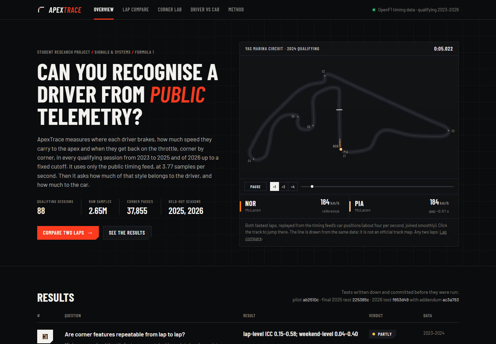
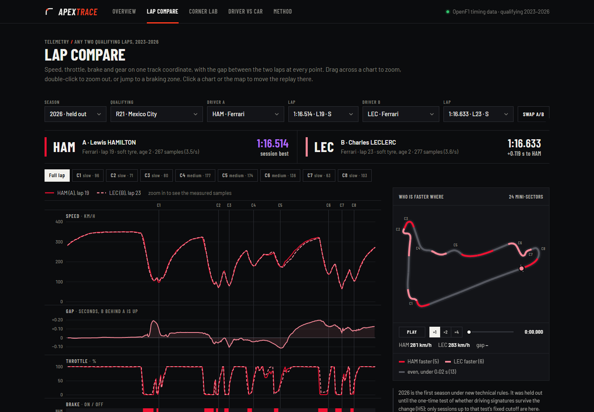
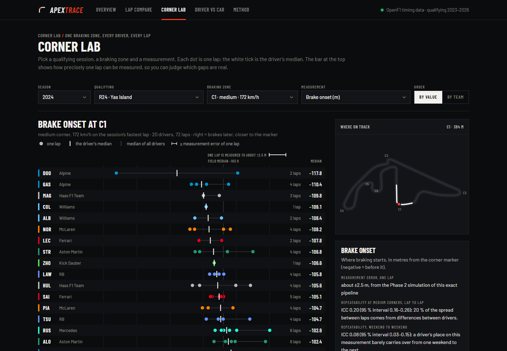
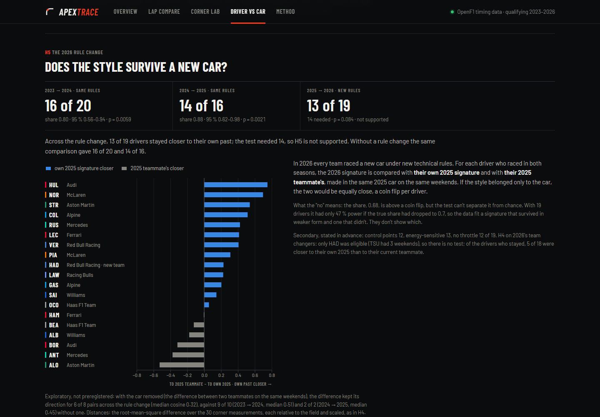
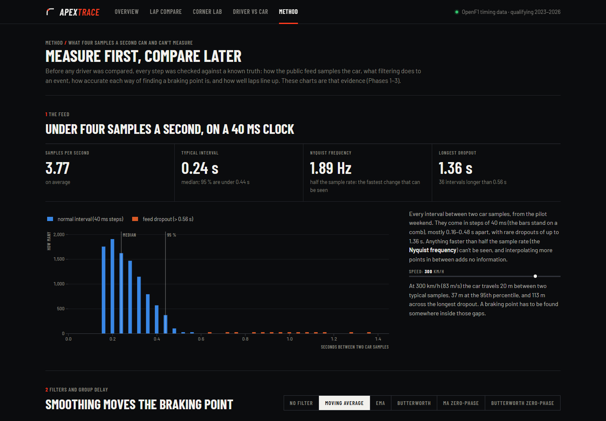

<!-- Generated by experiments/17_write_docs.py from docs/templates/README.md.j2: edit the template, not this file. Every number comes from results/. -->
# ApexTrace

**Driving signatures from public Formula 1 telemetry: a signal-processing research project.**

[](https://github.com/SadMan-ZaMaN/ApexTrace/actions/workflows/tests.yml)



Can you recognise a Formula 1 driver from the public timing feed alone, and how much of a driver's
"style" belongs to the driver rather than the car?

ApexTrace measures where each driver brakes, how much speed they carry to the slowest point and when they
get back on the throttle, in every braking zone of every qualifying session from 2023 to 2025. It uses only
public timing data, sampled about 3.77 times a second. The 2025 season was locked away from the first day
and used once, for a preregistered final test; 2026, the first season under new technical rules, was locked away in
the same way for a second one.

## Results

| | Question | Result | Verdict |
|---|---|---|---|
| H1 | Are corner features repeatable? | lap-level ICC 0.15–0.58, weekend-level 0.04–0.40 | partly |
| H2 | Do two teammates differ by more than the measurement error? (pilot) | 0 of 27 comparisons | not shown: too few laps, as predicted |
| H3 | Can corner features tell teammates apart on weekends the model never saw? | 2025: 0.662 vs 0.575 for lap time, 8 of 10 teams, p = 0.027 | **supported**, replicated on the held-out season |
| H4 | Does the style follow drivers who change teams? | 2025: 2 of 5 team changers, p = 0.81 | not supported |
| H5 | Does the style survive the 2026 rule change? | 2026: 13 of 19 drivers, p = 0.084 (14 needed) | not supported: can't tell weakened from lost |

In plain words:

- **Inside a team there is a measurable driver signature.** Using only how two teammates take their corners, a model
  tells them apart on unseen 2025 weekends with a balanced accuracy of 0.662 (0.5 = guessing), clearly better
  than lap time alone. From one year to the next, a driver's season signature stays closer to their own previous
  season than to their teammate's in the same car (17 of 20 drivers, p = 0.0013).
- **It does not beat simple whole-lap statistics** (0.680), such as the share of the lap spent braking.
  What the corner features add is that they are interpretable: they say *where* two drivers differ.
- **Whether the signature survives a change of car was not shown.** Only 2 of 5 drivers who moved
  in 2025 stayed closer to their own past than to their new teammate. Drivers who stayed in their team did so
  8 times out of 10 in the same comparison, but with five changers the difference can't be told
  from chance (p = 0.25). The car, or a driver adapting to it, matters a lot.
- **Nor was it shown to survive the 2026 rule change.** 13 of 19 drivers' 2026 signatures were closer to their own
  2025 signature than to their 2025 teammate's; the test needed 14. Without a rule change the same comparison gave
  16 of 20 and 14 of 16. As stated before the test, this "no" can't tell a signature that weakened from one
  that was lost: with 19 drivers the test had only 47 % power if the true share had dropped to 0.7.
  An exploratory check with the car removed (the difference between two teammates on the same weekends) leans towards
  "weakened": the difference pointed the same way after the rule change for 6 of 8 pairs, less strongly than without one.

The full write-up is in [docs/report.md](docs/report.md). The test plans were committed before they were run:
[docs/preregistration.md](docs/preregistration.md) (commits `ab2510c` and `225385c`; for 2026, `f653d49` with
Addendum 1, `ac3a793`), and every deviation is in
[docs/preregistration_deviations.md](docs/preregistration_deviations.md).

## The web app

A local Flask + D3 app shows the data and the results. It uses no logos or photos: every image is drawn from
the telemetry.

<table>
<tr>
<td width="50%"><br><b>Lap compare.</b> Any two qualifying laps: speed, throttle, brake and gear on one distance axis, the time gap at every metre, who was faster in each mini-sector, and a replay of both cars (×1/×2/×4, click a chart or the map to jump there).</td>
<td width="50%"><br><b>Corner lab.</b> One braking zone, every driver, every lap, with the per-lap measurement error drawn on the axis so real differences can be told from noise.</td>
</tr>
<tr>
<td width="50%"><br><b>Driver vs car.</b> The H4 test: each driver's 2025 style against their own 2024 style and their new teammate's, plus a 30-measurement "fingerprint".</td>
<td width="50%"><br><b>Method.</b> The measurement science as live charts: how the feed samples the car, how filters move a braking point, which estimators were chosen and why, and how laps are aligned.</td>
</tr>
</table>

## Why it is research, not a dashboard

- **Measurement before claims.** The feed is irregular (a 40 ms clock, gaps of up to 1.36 s in the pilot session, about 22 m between
  samples at 300 km/h, nothing faster than 1.89 Hz visible). Every feature was tested on synthetic laps with a
  known truth first. For example, "the first sample with the brake on" is 12.5 m late on average; the chosen
  estimator has 4.2 m error. A causal moving average shifts the middle of a braking event by 25.1 m, so events are
  located on raw samples.
- **Alignment.** Laps are placed on one track coordinate by a complementary filter (integrated speed + car position),
  with 1.15 m along-track error.
- **No leakage, honest baselines.** Identification is always leave-one-weekend-out and is compared with lap time,
  simple lap statistics and shuffled labels (which score 0.507, as they should).
- **Frozen test sets.** 2025 was refused by the code until the preregistration was committed, then run once. A
  crash before any result, and a team changer missing from the plan, are both reported as deviations. 2026 was
  handled the same way; its first run stopped at a data check before any result (a "no value" marker in the feed),
  and the fix was written down and committed as an addendum before the second run.

## Run it

```powershell
python -m venv .venv
.venv\Scripts\python.exe -m pip install -r requirements.txt
.venv\Scripts\python.exe -m pip install -e .
.venv\Scripts\python.exe -m pytest          # all tests, on synthetic data (also run by GitHub Actions)
.venv\Scripts\python.exe run.py             # the web app: http://127.0.0.1:5000
```

The Overview, Corner lab and Driver vs car pages work from the committed results. The Lap compare page also needs
the raw lap samples, which are not in the repository: `experiments/08_download_openf1.py` and
`experiments/09_build_dataset.py` download and rebuild them from OpenF1 (the logged download took 68 minutes:
OpenF1 limits the request rate).

## Repository map

| Folder | What |
|---|---|
| `src/apextrace/` | the package: data loading, quality checks, filters, alignment, events, features, statistics, identification, signatures |
| `experiments/` | numbered scripts `00`–`29`; every number and figure comes from one of them |
| `results/` | small outputs (JSON, CSV, figures); `results/final/` and `results/final_2026/` hold the frozen 2025 and 2026 tests |
| `app/` | the web app (Flask, vanilla JavaScript, D3) |
| `tests/` | pytest tests on synthetic signals; they never download F1 data |
| `docs/` | report, preregistration, deviations, research log, decisions, data report, related work, [data sources](docs/sources.md), 2026 rules notes, [engineering notes](docs/engineering_notes.md) (conventions and bug history) |

## Limitations

Qualifying laps only; a public feed at about 3.77 Hz with an on/off brake signal (no pressure); position data
too coarse to see racing lines; five team changers in the final test, so H4 could only pass if all five agreed;
19 drivers and a part season (19 sessions with data, up to Mexico City) for H5. The report lists these and more.

## Licence and citation

- **Code** (`src/`, `app/`, `experiments/`, `tests/`) and documentation: [MIT](LICENSE).
- **Derived data and figures** (`results/`, `docs/images/`): [CC BY-NC-SA 4.0](results/LICENSE.md), the licence under
  which OpenF1 publishes its data. Non-commercial use, with credit, under the same licence.
- **Bundled:** D3 (ISC licence) and the Barlow typeface (SIL Open Font License), with their licence files in `app/static/`.
- **Citing:** [CITATION.cff](CITATION.cff) (GitHub's "Cite this repository" button reads it).

## Notices

ApexTrace is an independent, non-commercial student project (BUET, CSE). It is unofficial and is not associated in
any way with the Formula 1 companies. F1, FORMULA ONE, FORMULA 1 and related marks are trade marks of Formula One
Licensing B.V. Data come from [OpenF1](https://openf1.org) and [FastF1](https://github.com/theOehrly/Fast-F1) (what was downloaded,
when and how: [docs/sources.md](docs/sources.md)); the author does not own the underlying Formula 1 timing data.

*This README is generated: edit `docs/templates/README.md.j2` and run `experiments/17_write_docs.py`.*
