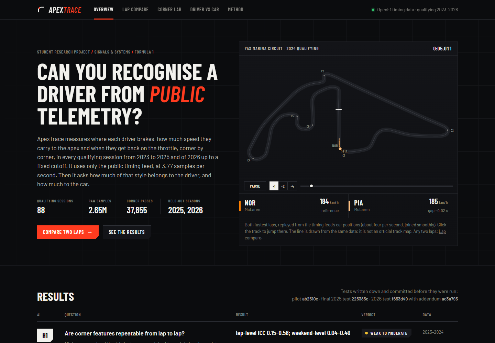
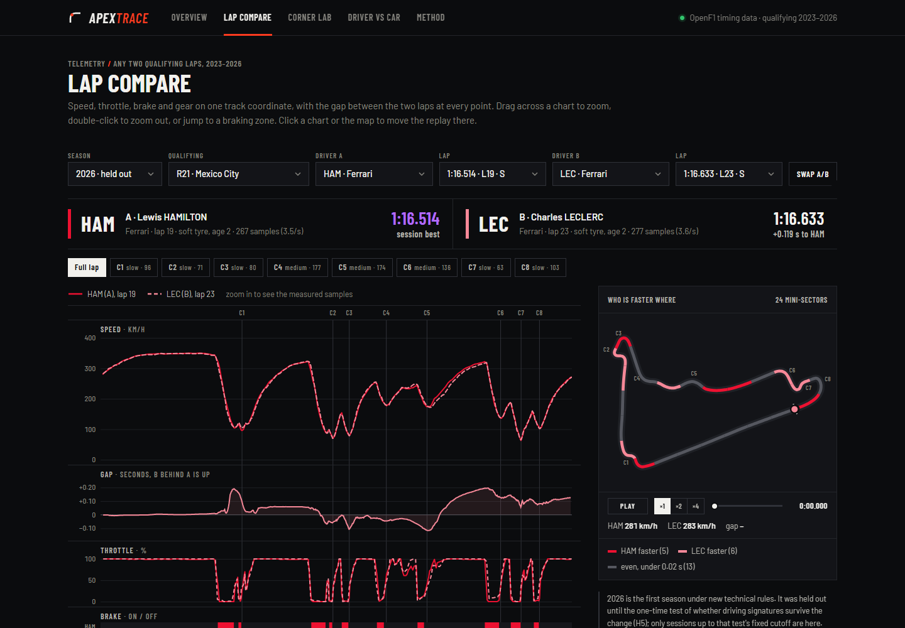
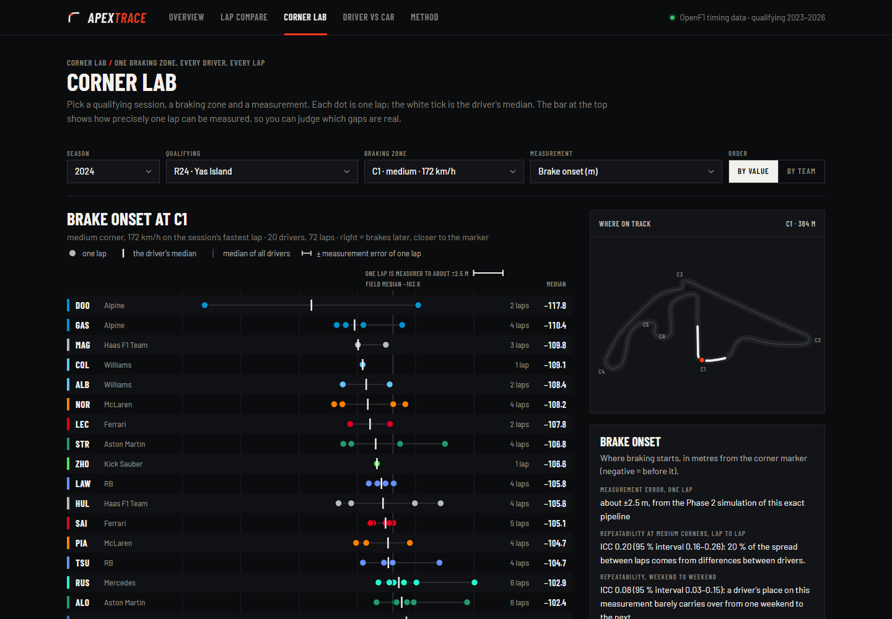
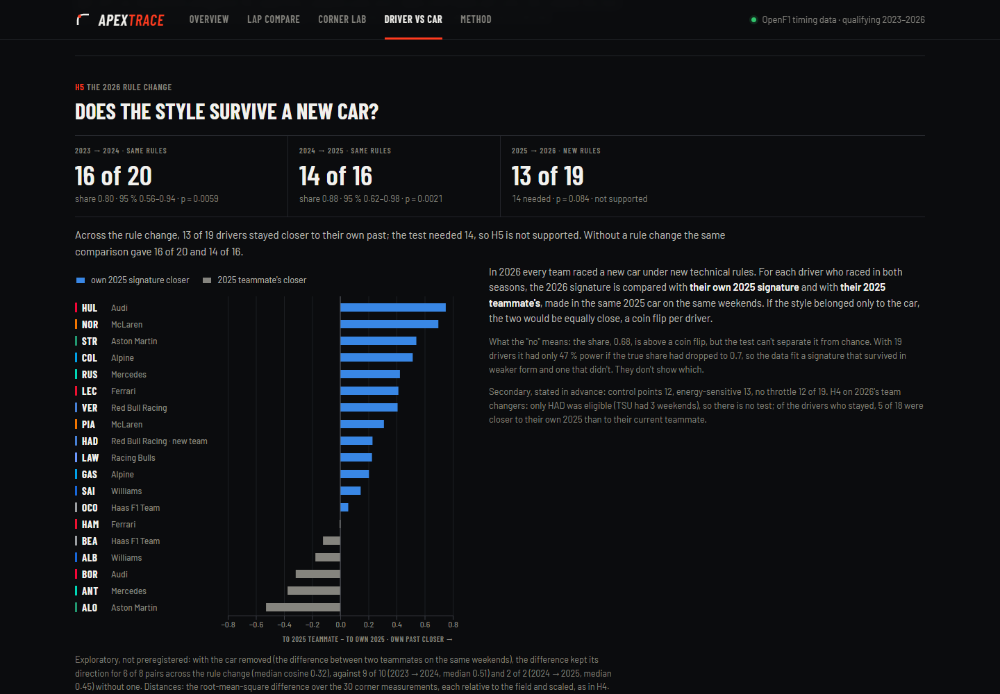
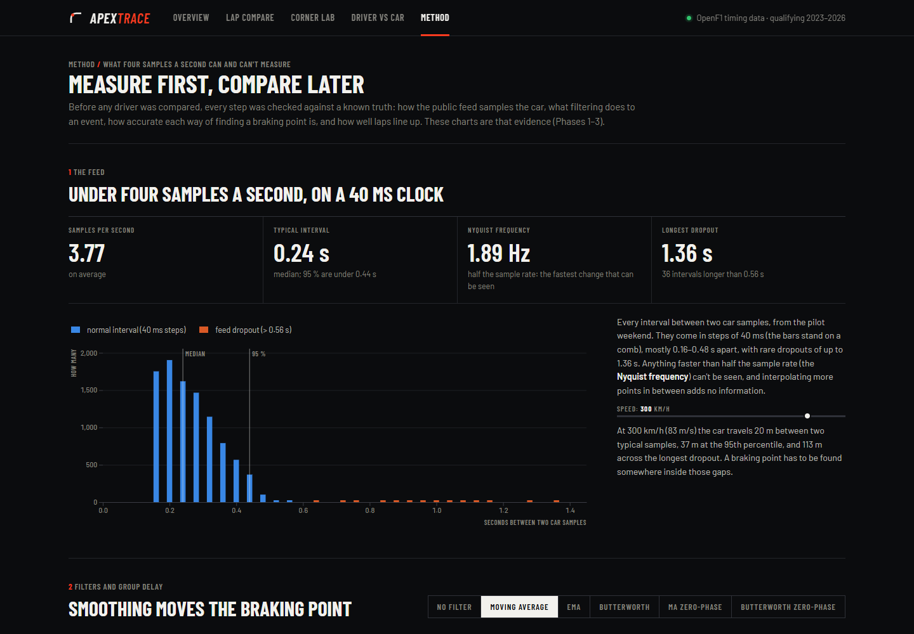

<!-- Generated by experiments/17_write_docs.py from docs/templates/README.md.j2: edit the template, not this file. Every number comes from results/. -->
# ApexTrace

Driving signatures from public Formula 1 telemetry.

[](https://github.com/SadMan-ZaMaN/ApexTrace/actions/workflows/tests.yml)



I'm a CSE student at BUET and a big Formula 1 fan. After a signals and systems course I wanted to find out
whether you can recognise a driver from the free public timing data, and how much of what looks like a
driver's style really comes from the car.

ApexTrace looks at every braking zone of every qualifying lap from 2023 to 2025, and of 2026 up to a fixed
cutoff. For each one it measures where the driver starts braking, how much speed they keep through the slowest
point, and when they get back on the throttle. The catch is the data: it arrives only about 3.77 times a
second, with gaps. So a big part of the project was working out how accurate each of those measurements can
be before trusting any of them.

I kept two seasons locked away while I worked. 2025 was used once, at the end, for a test I had written down and
committed beforehand. 2026, the first year of the new technical rules, got the same treatment.

## Results

| | Question | Result | Verdict |
|---|---|---|---|
| H1 | Are corner features repeatable? | lap-level ICC 0.15–0.58 (2 of 30 at 0.5 or more), weekend-level 0.04–0.40 | weak to moderate; includes the car |
| H2 | Do two teammates differ by more than the measurement error? (pilot) | 0 of 27 comparisons | not shown: too few laps, as predicted |
| H3 | Can corner features tell teammates apart on weekends the model never saw? | 2025: 0.662 vs 0.575 for lap time, 8 of 10 teams, p = 0.027 | **supported**, replicated on the held-out season |
| H4 | Does the style follow drivers who change teams? | 2025: 2 of 5 team changers, p = 0.81 | not supported |
| H5 | Does the style survive the 2026 rule change? | 2026: 13 of 19 drivers, p = 0.084 (14 needed) | not supported: can't tell weakened from lost |

**Teammates can be told apart.** Looking only at how two teammates take their corners, a model picks the right
driver on 2025 weekends it never saw with a balanced accuracy of 0.662 (0.5 would be guessing), clearly better than
lap time alone. To be fair about what that shows: it separates a driver together with their side of the garage
(set-up, maybe parts, how far they got in qualifying), not the driver on their own. Across 2023 and 2024, a
driver's season signature stayed closer to their own previous season than to their teammate's for 16 of 20
drivers (p = 0.0059).

**Simple lap statistics do just as well.** Numbers like the share of the lap spent braking reach 0.680. The
corner measurements don't beat them. What they add is that they show *where* two drivers differ. Giving a
model both kinds of input helped only a little (+0.021 in development, +0.025 in 2025), too little to be sure about.

**The style didn't clearly follow drivers to a new team.** Only 2 of 5 drivers who moved in 2025 stayed
closer to their old selves than to their new teammate. That "no" is weak evidence, though. Drivers who stayed in
their team passed the same comparison 8 times out of 10 in 2025, but only 11 of 20 from 2023 to 2024, so the
comparison itself leans towards the current teammate.

**It wasn't shown to survive the 2026 rule change either.** 13 of 19 drivers stayed closer to their own 2025
signature than to their 2025 teammate's; the test needed 14. Without a rule change the same comparison gave
16 of 20 and 14 of 16. I said before running it that this test couldn't tell a weaker signature from a
lost one: with 19 drivers it had only 47 % power if the true share had dropped to 0.7. A rough check that takes
the car out (comparing teammates on the same weekends) points to "weaker": for 6 of 8 teammate pairs, the
difference between them kept its direction across the rule change.

The full write-up is in [docs/report.md](docs/report.md). The test plans were committed before they were run
([docs/preregistration.md](docs/preregistration.md): commits `ab2510c` and `225385c`, and for 2026 `f653d49`
with Addendum 1 in `ac3a793`), and every place where I had to deviate from them is listed in
[docs/preregistration_deviations.md](docs/preregistration_deviations.md).

## The web app

A small local app (Flask and D3) shows the data and the results. Everything on it is drawn from the telemetry;
there are no logos or photos.

<table>
<tr>
<td width="50%"><br><b>Lap compare.</b> Any two qualifying laps from 2023 to 2026 (here, 2026 Mexico City) on one distance axis: speed, throttle, brake, gear, the time gap at every metre, who was faster in each mini-sector, and a replay of both cars. If the feed has a hole in a lap, the page says so instead of drawing across it.</td>
<td width="50%"><br><b>Corner lab.</b> One braking zone, every driver, every lap. The measurement error is drawn on the axis, so you can see which differences are real and which are noise.</td>
</tr>
<tr>
<td width="50%"><br><b>Driver vs car.</b> The H3, H4 and H5 tests. Shown here: H5, each driver's 2026 signature against their own 2025 one and their old teammate's, next to the same comparison in years without a rule change.</td>
<td width="50%"><br><b>Method.</b> The measurement side as live charts: how the feed samples the car, how filters move a braking point, which estimators I chose and why, and how laps are lined up.</td>
</tr>
</table>

## How I tried to keep it honest

**Measure first.** The feed runs on a 40 ms clock, with gaps of up to 1.36 s in the pilot session and about 22 m
between samples at 300 km/h, so nothing faster than 1.89 Hz is visible. Before trusting any measurement on real
laps, I tested it on simulated laps where I knew the right answer. The obvious braking point, the first sample
with the brake on, turns out to be 12.5 m late on average; the method I use instead has about 4.2 m error. A normal
moving average shifts a braking event by 25.1 m, so events are always found on the raw samples.

**One distance axis for every lap.** Integrated speed is smooth but drifts; the car's position doesn't drift but
is noisy. A simple complementary filter combines the two, with a random error of about 1.15 m on the pilot session.

**Fair comparisons.** The model is always tested on whole weekends it never saw, and compared with lap time,
simple lap statistics and shuffled labels (which score 0.507, as they should).

**Locked test seasons.** The code refused to load 2025 until its test plan was committed; then it ran once. A
crash before any result and a team changer I had missed are both reported as deviations. 2026 went the same way.
Its first run stopped at a data check (the feed uses the value 104 for "no value"), and I wrote down and committed
the fix as an addendum before running it again.

**Re-checking everything.** `experiments/30_audit.py` re-runs every development experiment with the internet
blocked (no result may change), recomputes the three preregistered tests from the saved data, and checks the
numbers in the hand-written documents. Last full run: 2026-11-19, 27 experiments re-run, all checks passed.

## How it was built

I built this over about six weeks in October and November 2026, with a lot of help from an AI coding assistant
(Claude, by Anthropic). It wrote much of the code and the first drafts of the documents under my direction. I set
the questions and the plan, and reviewed and committed every change. Every number in this README and in the report
is filled in from the results files by a script, and the tests check that they still match.

## Run it

```powershell
python -m venv .venv
.venv\Scripts\python.exe -m pip install -r requirements.txt
.venv\Scripts\python.exe -m pip install -e .
.venv\Scripts\python.exe -m pytest          # all tests, on synthetic data (GitHub Actions runs them too)
.venv\Scripts\python.exe run.py             # the web app: http://127.0.0.1:5000
```

The Overview, Corner lab and Driver vs car pages work straight from the committed results. Lap compare also needs
the raw lap samples, which aren't in the repository: `experiments/08_download_openf1.py` and
`experiments/09_build_dataset.py` download and rebuild them from OpenF1 (my download took 68 minutes, because
OpenF1 limits how fast you can ask).

## Repository map

| Folder | What |
|---|---|
| `src/apextrace/` | the package: data loading, quality checks, filters, alignment, events, features, statistics, identification, signatures |
| `experiments/` | numbered scripts `00`–`34`; every number and figure comes from one of them |
| `results/` | small outputs (JSON, CSV, figures); `results/final/` and `results/final_2026/` hold the frozen 2025 and 2026 tests |
| `app/` | the web app (Flask, vanilla JavaScript, D3) |
| `tests/` | pytest tests on synthetic signals; they never download F1 data |
| `docs/` | report, [one-page summary (PDF)](docs/summary.pdf), preregistration, deviations, research log, decisions, data report, related work, [data sources](docs/sources.md), 2026 rules notes, [ML plan](docs/ml_plan.md), [engineering notes](docs/engineering_notes.md) (conventions and bug history) |

## Limitations

Only qualifying laps. The public feed comes at about 3.77 Hz, the brake is only on or off (no pressure), and the
position data are too coarse to see racing lines. The 2025 test had just five team changers, so H4 could only pass
if all five agreed, and H5 rests on 19 drivers and part of a season (19 sessions with data, up to Mexico City). The
report goes through these and a few more.

## Licence and citation

- **Code** (`src/`, `app/`, `experiments/`, `tests/`) and documentation: [MIT](LICENSE).
- **Derived data and figures** (`results/`, `docs/images/`): [CC BY-NC-SA 4.0](results/LICENSE.md), the licence OpenF1
  uses for its data. Non-commercial use, with credit, under the same licence.
- **Bundled:** D3 (ISC licence) and the Barlow typeface (SIL Open Font License), with their licence files in `app/static/`.
- **Citing:** [CITATION.cff](CITATION.cff) (GitHub's "Cite this repository" button reads it).

## Notices

ApexTrace is an independent, non-commercial student project (BUET, CSE). It is unofficial and not associated in
any way with the Formula 1 companies. F1, FORMULA ONE, FORMULA 1 and related marks are trade marks of Formula One
Licensing B.V. The data come from [OpenF1](https://openf1.org) and [FastF1](https://github.com/theOehrly/Fast-F1) (what I downloaded,
when and how: [docs/sources.md](docs/sources.md)); I don't own the underlying Formula 1 timing data.

*This README is generated: edit `docs/templates/README.md.j2` and run `experiments/17_write_docs.py`.*
