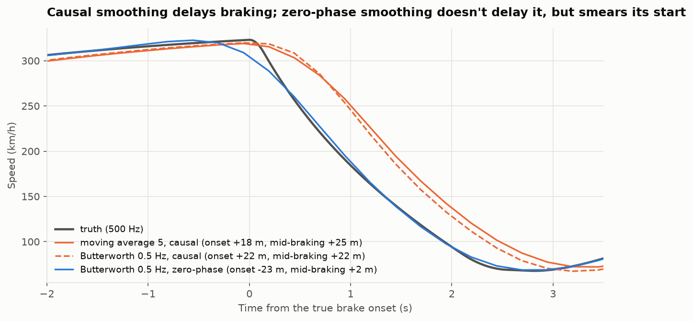
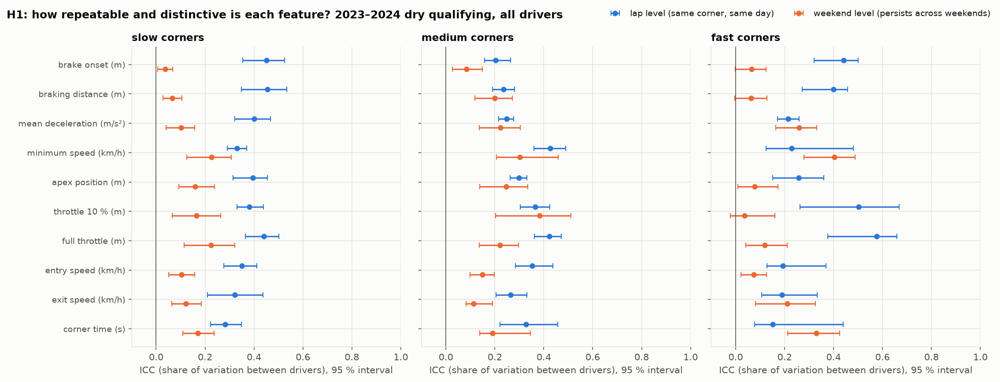
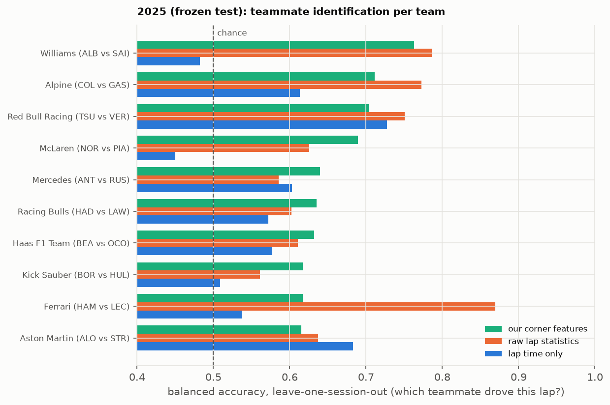
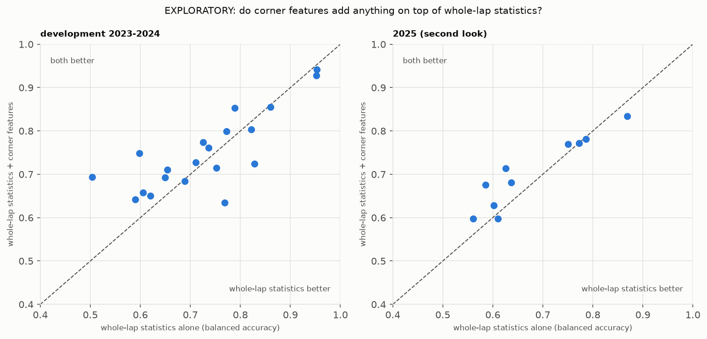
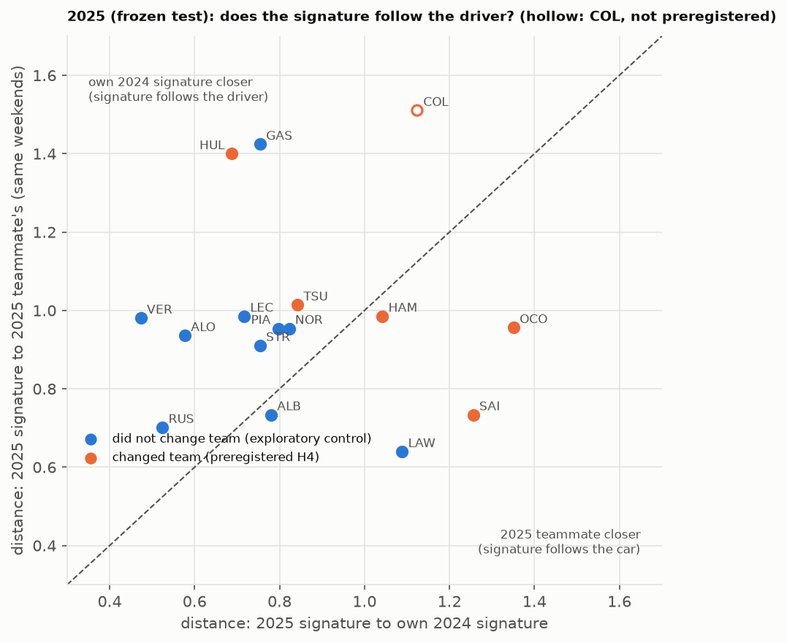
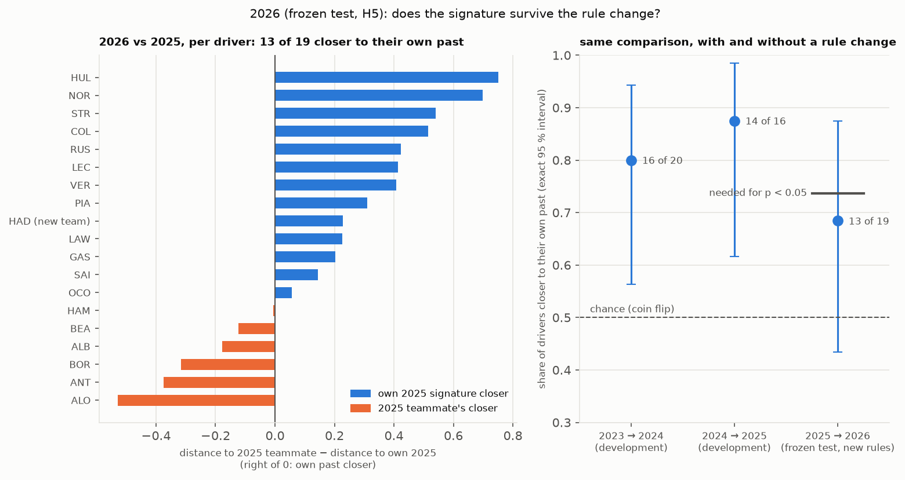
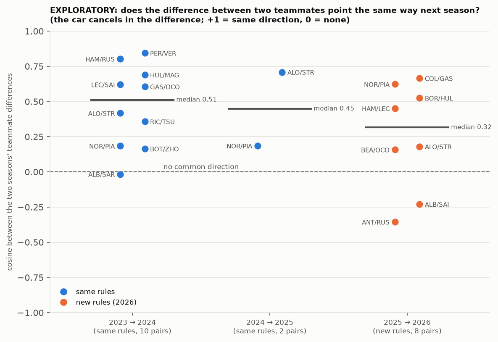

<!-- Generated by experiments/17_write_docs.py from docs/templates/report.md.j2: edit the template, not this file. Every number comes from results/. -->
# ApexTrace: driving signatures from low-rate public Formula 1 telemetry

**Sadman Zaman** · Department of Computer Science and Engineering, Bangladesh University of Engineering and Technology (BUET) · November 2026

## Abstract

Public Formula 1 timing data report each car's speed, throttle, an on/off brake flag, gear and position only
about 3.77 times per second, on an irregular clock with gaps. We ask whether signal-processing methods can still
extract repeatable, interpretable *driving signatures* from these data, whether those signatures identify a driver on
unseen sessions, and how much of them belongs to the driver rather than the car. We first quantify what the feed can
measure with synthetic laps of known truth, choose event estimators by Monte Carlo error, and place every lap on one
track coordinate with a complementary filter (1.15 m along-track error). From every braking zone of
66 dry qualifying sessions (2023–2025) we compute corner features such as brake onset, minimum speed and throttle pickup.
Features repeat lap to lap (intraclass correlation 0.15–0.58) but much less from weekend to weekend
(0.04–0.40). In a preregistered test on the held-out 2025 season, the features told teammates apart
on unseen weekends with balanced accuracy 0.662, against 0.575 for lap time (8 of 10 teams,
Wilcoxon p = 0.027), but not better than simple whole-lap statistics (0.680). Whether a signature follows a driver
to a new team was not supported: 2 of 5 team changers stayed closer to their own previous season than to
their new teammate (sign test p = 0.81). A second preregistered test, on 2026, the first season under new technical
regulations, did not support that the signature survives the rule change: 13 of 19 drivers' 2026 signatures were
closer to their own 2025 signature than to their 2025 teammate's (sign test p = 0.084; 14 were needed), against
16 of 20 and 14 of 16 in two pairs of seasons without a rule change. With 19 drivers, this "no" cannot tell a
weakened signature from a lost one.

## 1. Introduction

Television graphics and fan tools compare drivers through telemetry traces, but they rarely ask how precisely those
traces are measured, or whether an apparent difference would appear again next weekend. This project treats the
public feed as a measured signal with known limits, and tests five hypotheses, each of which could come out "no":

- **H1, repeatability.** Corner-level features vary less within a driver than between drivers.
- **H2, teammate differences.** Two teammates differ by more than the measurement error (pilot only).
- **H3, identification.** The features identify which of two teammates drove a lap, on sessions the model never
  saw, better than baselines including lap time alone.
- **H4, driver versus car.** A driver's signature follows them when they change teams.
- **H5, rule change.** A driver's signature survives the 2026 change of technical regulations: their 2026
  signature stays closer to their own 2025 signature than to their 2025 teammate's.

We do not claim who is the better driver, anything faster than the data can show, or brake pressure (the public
brake channel is on/off).

**Contributions.** (i) An error budget for corner features from 3.77 Hz public telemetry, built from synthetic
laps with known truth. (ii) A reproducible pipeline from raw feed to field-relative corner features for every
qualifying session of 2023–2025, and of 2026 up to a fixed cutoff. (iii) A leakage-free identification protocol with explicit baselines, replicated on a
season held out until a preregistered final test. (iv) A first, small test of whether driving style survives a change
of team, with an exploratory control, and a second held-out test of whether it survives a change of technical rules.
(v) A web application that shows every result with its uncertainty.

## 2. Related work

**Identifying drivers from vehicle data.** Drivers of road cars can be told apart from in-car sensor data (Enev et
al., 2016), and a single turn already carries much of the signature: Hallac et al. (2016) identified drivers from one
turn and found turns more informative than straights, and Chen, Cho and Shin (2017) reached 74–91 % accuracy from one
turn with phone motion sensors, for groups of 12 down to 5 drivers. Later work uses sequence models (Girma, Yan and
Homaifar, 2019; Govers et al., 2024). These studies log sensors inside the car. Here the data are a public broadcast
feed at about 3.77 samples per second with an on/off brake signal, the drivers to separate are teammates
in identical cars, and the test is on unseen weekends and an unseen season.

**Driving style in racing.** In simulators, telemetry separates human skill levels (Remonda, Veas and Luzhnica, 2021)
and individual drivers (Vogel et al., 2022). For Formula 1, Taylor and Secco (2026) cluster drivers on race-level
statistics such as lap-time consistency and tyre degradation. A 2026 scoping review of artificial intelligence in
motorsport (Lucaciu and Győrödi, 2026) finds race strategy and vehicle optimisation well covered; its abstract does not
mention driver identification or driving style.

**Driver versus car.** Separating the driver from the car has been studied on results: points (Eichenberger and
Stadelmann, 2009; Phillips, 2014; Bell et al., 2016), finishing positions, where about 88 % of the variance in
hybrid-era race results is attributed to the constructor (van Kesteren and Bergkamp, 2023), and qualifying lap times
with race results, where driver abilities are more stable over time than constructor abilities (Lindner et al., 2026).
These models use the same two sources of information as this project, teammates and team changes, but they explain
outcomes, not how the car is driven.

**Gap.** Our searches (a general web search engine, Semantic Scholar and OpenAlex, October 2026, plus the 126 papers
that cite Hallac et al., 2016) found no study that identifies
drivers from real Formula 1 telemetry on held-out sessions, quantifies the measurement error of corner features at the
public feed's sample rate, or separates driver from car at the level of driving style. This describes what we found,
not a proof that no such study exists.

## 3. Data

**Source.** Timing data come from Formula 1's live-timing feed, read through two free, unofficial interfaces. The pilot used FastF1;
when the F1 archive began refusing requests (HTTP 401) we switched to OpenF1, which serves the same feed. On the
pilot weekend (2024 Abu Dhabi), the two sources gave identical kept laps for 20 of 20 drivers in qualifying and
20 of 20 in practice, and brake-onset features within 0.23 m.

**What the feed is.** Car data arrive on a 40 ms clock at 3.77 samples per second on average (median interval
0.24 s, 5–95 % range 0.16–0.44 s, dropouts up to 1.36 s in the pilot session). At 300 km/h that is about 22 m
between samples, and nothing faster than 1.89 Hz can be resolved. Speed is reported in whole km/h, throttle in
whole percent, and the brake as on/off. Position (X/Y) is too coarse to show racing-line differences. For throttle and
brake the feed sends the value 104 when it has no value. Inside kept laps this was rare in 2023–2025 (share of
throttle samples: 2023 0.015 %, 2024 0.006 %, 2025 0.007 %) but affected 1.13 % of 2026 samples (the highest shares per session:
Suzuka 8.3 %, Shanghai 8.0 %, Monza 1.1 %); such samples are dropped as missing (Section 6.6).

**Sessions.** Main qualifying sessions of 2023–2024 for development (47 sessions listed, 46 with data
because the 2023 Imola weekend was cancelled; 4,500 kept laps, 4,497 of them with at least one usable corner pass, 25 drivers) and of 2025 for the final test
(24 sessions; OpenF1 has no lap data for one, so 23 were built). The 2026 season, the second final test, was
still running: the test used the 21 qualifying sessions that ended before a cutoff fixed in advance (2026-11-06 00:00 UTC),
the last being Mexico City. OpenF1 has no lap data for two of them (Sakhir and Jeddah), so 19 were built, with
1,795 kept laps; 1,764 still had car data once the marker samples were removed (Section 6.6), 1,752 had
at least one usable corner pass and 1,751 at least one clean one. Laps were kept by FastF1-style
rules (timed, accurate, not an out or in lap, green flag, not deleted, within 107 % of the best lap of the same stint).
Braking zones were detected automatically on each session's fastest kept lap and typed slow (< 120 km/h minimum),
medium or fast (≥ 200 km/h).

**Cleaning.** Rules were fixed in an exploratory data analysis of 2023–2024 and applied unchanged to 2025 and 2026: dry
compounds only, corner passes with an implausible minimum speed dropped, and impossible feature values (for example,
braking after the corner marker) set to missing. This leaves 21,493 clean (driver, lap, corner) rows in
44 dry development sessions, 8,871 rows in 22 dry 2025 sessions and 7,491 rows in
the 19 sessions of 2026.

**The frozen seasons.** From the first day, the code refused to load 2025 unless an environment flag was set, and the
final script refused to run unless the preregistration was committed, unchanged, and had not been run before. 2026 was
locked the same way, with its own flag, from 2026-10-26 (no 2026 data had been downloaded before; the cache was
checked) until its test plan was committed. Until then the project read only the 2026 rule texts; what the author knew
of the season from following it is disclosed in the plan (Part C).

## 4. Measurement science

Every estimator was tested on synthetic laps with a known truth (realistic speed profiles, the feed's irregular
sampling and dropouts, whole-unit quantisation), with 1,000 laps per corner type.

**Filtering moves events.** A causal 5-sample moving average shifted the middle of a braking event by
25.1 m, and a causal 0.5 Hz Butterworth filter by 22.3 m (group delay). Zero-phase filtering removes
the shift of the middle (3.4 m) but smears the onset −35.8 m early. Events are therefore located
on the raw samples, and smoothing is never used for a reported value.

**Estimator choices** (heavy-braking corners, root-mean-square error):

| Feature | Naive estimator | Chosen estimator |
|---|---|---|
| Brake onset | first sample with the brake on: 14.9 m (late by 12.5 m on average) | speed breakpoint inside the off→on interval: 4.2 m |
| Slowest point (apex) | lowest sample: 2.1 m | parabola through the three slowest samples: 1.0 m |
| Minimum speed | | parabola: 0.36 km/h |
| Throttle pickup (10 %) | first sample above: 3.2 m | interpolated crossing: 1.3 m |

Peak deceleration cannot be measured: the best estimator still had 8.0 m/s² error, so the mean deceleration from
brake onset to the slowest point is used instead.

**Alignment.** Projecting X/Y onto a reference path gives a track coordinate that is right on average but noisy;
integrating speed gives one that is smooth but drifts. A complementary filter (integrated speed plus a low-pass
correction from position, weighted by 1/speed²) gives 1.15 m along-track error in each corner window.

## 5. Features and statistical design

**Features.** For each (driver, lap, corner): brake onset, entry speed (200 m before the marker), minimum speed,
slowest point, braking distance, mean deceleration, throttle pickup, full throttle, exit speed (150 m after), corner
time and minimum gear (11 features). Positions are in metres from the corner marker. For comparisons across
tracks, each value is taken relative to the field median at the same corner and session (*field-relative*).

**Repeatability (H1).** The intraclass correlation ICC(1) gives the share of the variance that lies between drivers,
at two levels: laps within a weekend, and weekend means within a season. Intervals come from a bootstrap that
resamples whole driver-seasons.

**Identification (H3).** For each team-season, a logistic regression (with imputation and scaling fitted on training
data only) predicts which teammate drove a lap from 30 numbers: the field-relative mean of 10 features over the
lap's slow, medium and fast corners. Evaluation is leave-one-weekend-out, the score is balanced accuracy, and every
model is compared with a majority guess, lap time only, simple whole-lap statistics (mean and top speed, mean
throttle, share at full throttle, share braking) and shuffled labels. Ours vs lap time is a two-sided Wilcoxon
signed-rank test over teams.

**Driver vs car (H4).** A season signature is the mean of a driver's weekend means (each weekend counts once),
z-scored with the 2024 spread; the distance between signatures is the root-mean-square difference. For each
driver who changed teams for 2025, we ask whether their 2025 signature is closer to their own 2024 signature (another
car) than to their new teammate's 2025 signature (the same car, the same weekends). One-sided sign test over the
changers.

**Rule change (H5).** For every driver with at least 5 weekends in both 2025 and 2026, the 2026 signature is compared
with the driver's own 2025 signature (another car, other rules) and with their 2025 teammate's (the same 2025 car). If
the signature belongs to the driver, it should stay closer to their own past. Three rules make the comparison fair:
both 2025 references use only the weekends the two teammates shared, and the same number of laps per shared weekend
(each driver's first laps); and the z-score spread comes from the other drivers, with the pair left out. Each rule was
added after a synthetic test in which only the car matters, so that the true answer is a coin flip (0.5): with the pair
inside the spread the share came out 0.43, and with all laps of a teammate who had fewer laps 0.73; with the rules it
is 0.50. Two teammates' answers are not independent, because each uses the other as reference: in that test,
pairs split one-and-one 71 % of the time and the whole test had a false-positive rate of 0.007 (at most 0.05 is
allowed), so the sign test is conservative here. One-sided sign test, p < 0.05. Three secondary feature sets (control
points, energy-sensitive, no throttle) are reported but do not decide. H4 is repeated on the 2026 team changers, found
from the data by a fixed rule (team lineages across renames), with the drivers who stayed as a control.

**Preregistration.** The pilot tests (Part A, commit `ab2510c`), the final 2025 evaluation (Part B, commit
`225385c`) and the 2026 test (Part C, commit `f653d49`, with Addendum 1, commit `ac3a793`) were committed
before they were run. Deviations are reported in a separate file and below.

## 6. Results

### 6.1 Pilot (H2): too few laps, as predicted

Norris vs Piastri, 2024 Abu Dhabi qualifying, 4 and 4 push laps: 0 of 27 feature-by-corner comparisons survived
Benjamini–Hochberg correction, as the preregistration predicted from the smallest possible p-values. The largest
effects: Norris braked 7.4 m later at T5 (Hedges' g 2.2, p = 0.057) and 7.2 m later at T9 (g 1.9, p = 0.057):
consistent with a real difference, not confirmed.

### 6.2 Repeatability (H1): partly

Across all 2023–2024 drivers, lap-level ICCs ranged from 0.15 to 0.58, and weekend-level ICCs from 0.04 to
0.40. The lap-to-lap spread was 2.9 to 28 times the per-lap measurement error in all 21 cases where the error
was simulated, so the variation is the drivers', not the instrument's. The features that carry over best between
weekends are min_speed_kmh (fast, 0.40), throttle_pickup_m (medium, 0.38), corner_time_s (fast, 0.33). Brake onset at slow corners repeats within a weekend
(ICC 0.45) but hardly between weekends (0.04).

### 6.3 Identification (H3): supported, and replicated on 2025

| Balanced accuracy (mean over teams) | Development 2023–2024 (20 team-seasons) | Final 2025 (10 teams) |
|---|---|---|
| Corner features | 0.685 [0.654, 0.716] | **0.662** [0.634, 0.694] |
| Lap time only | 0.565 [0.538, 0.592] | 0.575 [0.527, 0.626] |
| Whole-lap statistics | 0.729 [0.680, 0.780] | 0.680 [0.621, 0.745] |
| Corner features, weekend vote | 0.763 | 0.746 |
| Shuffled labels | 0.500 | 0.507 |
| Ours better than lap time | 18 of 20, p < 0.001 | 8 of 10, p = 0.027 |
| Ours better than whole-lap statistics | 8 of 20, p = 0.14 | 5 of 10, p = 1 |

The preregistered criterion (Wilcoxon p < 0.05 and ours higher than lap time) was met on 2025. Shuffled labels sit at
chance, so the pipeline does not leak. Removing the throttle features costs the most (0.592 without them in
2025). The whole-lap statistics are as good or better; the extreme case is Ferrari 2025 (Hamilton vs Leclerc),
0.87 for whole-lap statistics vs 0.62 for corner features. Across all drivers of a season (a harder task: 21 and 22
drivers), corner features reached 0.240 in 2024 (chance 0.045, lap time 0.087, whole-lap statistics 0.287);
lap time alone is little better than chance there.

**Exploratory, not preregistered: do corner features add anything on top of whole-lap statistics?**
(`experiments/32_combined_inputs.py`; rules in `docs/decisions.md`, 2026-11-13.) The same protocol with both inputs
together (35 numbers) reached 0.750 in development and 0.705 in 2025, against 0.729 and 0.680 for the
whole-lap statistics alone: a difference of +0.021 (95 % interval −0.010 to +0.052, higher for 12 of
20 team-seasons) and +0.025 (+0.001 to +0.050, 6 of 10). By the words fixed in advance, development
reads "no clear gain from adding corner features to whole-lap statistics" and 2025 "corner features add information beyond whole-lap statistics", although the 2025
interval only just excludes zero. Taken together: a small gain of about two points, the same in direction in both,
uncertain in size. The other way round, adding the whole-lap statistics to the corner features helps clearly
(+0.064, +0.038 to +0.097; +0.043, +0.007 to +0.089). So most of what tells teammates apart is
either shared by the two inputs or sits in the whole-lap statistics; the corner features add a little on top, and their
main value is that they show where two drivers differ. (A neural network on the raw corner traces was planned as an
optional step and not done: no unused test season is left, and the data are small for it.)

### 6.4 Driver vs car (H4): not supported

**Development (2023 → 2024, same car both years).** A driver's 2024 signature ranked their own 2023 signature
3.05 of 21 on average (chance 11; first for 12 of 20, permutation p < 0.001) and was closer to it than to the
teammate's for 17 of 20 drivers (p = 0.0013).

**Final test (2025 team changers).**

| Driver | 2024 → 2025 | Distance to own 2024 | Distance to new teammate | Closer to | Own 2024 rank |
|---|---|---|---|---|---|
| HAM | Mercedes → Ferrari (LEC) | 1.04 | 0.99 | new teammate | 4 of 22 |
| SAI | Ferrari → Williams (ALB) | 1.26 | 0.73 | new teammate | 15 of 22 |
| OCO | Alpine → Haas F1 Team (BEA) | 1.35 | 0.96 | new teammate | 12 of 22 |
| HUL | Haas F1 Team → Kick Sauber (BOR) | 0.69 | 1.40 | own 2024 | 1 of 22 |
| TSU | RB → Red Bull Racing (VER) | 0.84 | 1.01 | own 2024 | 2 of 22 |

2 of 5 changers stayed closer to their own past: sign test p = 0.81 (the smallest possible p with five drivers
was 0.031, so all five had to agree). H4 is not supported. Secondary results: the share of the lap spent
braking stayed closer to the driver's own for 4 of 5 (p = 0.19), and drivers who did not change
teams kept their signature against their old teammate for 10 of 11 (p = 0.0059).

**Exploratory, not preregistered.** Running the same comparison on the drivers who stayed (own 2024 vs current
teammate, same weekends) gave 8 of 10 (p = 0.055). Changers (2 of 5) and stayers (8 of 10) can't be told apart with
these numbers (Fisher's exact p = 0.25).

### 6.5 Rule change (H5, 2026): not supported

| Drivers closer to their own past than to their past teammate | Count | Share (exact 95 % interval) | Sign test |
|---|---|---|---|
| 2023 → 2024 (development, same rules) | 16 of 20 | 0.80 (0.56–0.94) | p = 0.0059 |
| 2024 → 2025 (development, same rules) | 14 of 16 | 0.88 (0.62–0.98) | p = 0.0021 |
| **2025 → 2026 (frozen test, new rules)** | **13 of 19** | 0.68 (0.43–0.87) | p = 0.084 |
| 2026, control points only | 12 of 19 | 0.63 (0.38–0.84) | p = 0.18 |
| 2026, energy-sensitive features only | 13 of 19 | 0.68 (0.43–0.87) | p = 0.084 |
| 2026, without throttle features | 12 of 19 | 0.63 (0.38–0.84) | p = 0.18 |

13 of 19 is one short of the 14 the preregistered test needed, so H5 is **not supported**. The secondary feature sets
agree. 24 drivers appear in the 2026 data; the 5 not compared have no 2025 qualifying data (BOT, HIR, LIN, PER) or
fewer than 5 weekends in 2026 (TSU with 3). In the figure, HAM's two distances differ by only 0.005, a near tie.

**What this "no" means.** Part C stated in advance that this test cannot tell a weakened signature from a lost one.
The share, 0.68, is above one half, and its interval (0.43–0.87) includes both chance and the development rates. With
19 drivers the test would have said "yes" with probability 84–98 % if 2026 had kept the development rates, but only
47 % if the true rate had dropped to 0.7. The data fit a signature that survived in weaker form and one that did
not survive; they do not show which.

**Exploratory, not preregistered.** Of the 9 pairs of 2025 teammates in which both drivers were compared,
6 split one-and-one (one closer to their own past, the other to the teammate), 3 went to the own past for
both, and 0 to the teammate for both. A split is what a car-only effect produces (71 % of pairs in the synthetic
test). So the 13 are 6 from split pairs, 6 from the 3 pairs that both kept their own past, and
1 from VER (2025 teammate TSU).

**H4 on the 2026 team changers (secondary).** The fixed rule found 2 drivers whose team lineage changed for 2026:
HAD (Racing Bulls → Red Bull Racing) and TSU (Red Bull Racing → Racing Bulls), who has only
3 weekends in the 2026 data, fewer than the 5 required. With 1 eligible changer no test is possible (Part C: at least
5 are needed), so it is descriptive: HAD's 2026 signature was 1.36 from their own 2025 signature
and 0.99 from the new teammate's (VER), so closer to the new teammate. In the control, 5 of 18 drivers who
stayed in their team were closer to their own 2025 signature than to their current teammate's (0.28, 0.10–0.53),
so for the other 13 the teammate in the same 2026 car was closer; the same comparison gave 11 of 20 and 8 of 10
on the development seasons.

**Corner types.** The braking zones of 2026 are slower:

| Braking zones per session | slow (< 120 km/h) | medium | fast (≥ 200 km/h) |
|---|---|---|---|
| 2025 | 3.17 | 2.74 | 0.87 |
| 2026 | 3.84 | 2.47 | 0.58 |

This is the direction expected with less downforce (`docs/regulations_2026.md`), but the calendars differ, so it is
descriptive. It also means that the "fast" part of a 2026 signature rests on fewer corners.

### 6.6 Deviations from the plan

1. The first 2025 run crashed while downloading, before any result existed: OpenF1 has no lap data for 2025 Baku
   qualifying. The session is skipped (a one-line fix with a test); the deviation was recorded before the rerun.
2. Franco Colapinto (Williams → Alpine) also changed teams but was missing from the preregistered list. The primary test
   was kept as planned; with him included the result is 3 of 6 (p = 0.66), so the conclusion does not change.
3. The first 2026 run (after Part C, commit `f653d49`) stopped at the feed check, before any feature was computed:
   1.13 % of the samples inside kept laps had 104, the feed's "no value" marker (Section 3), in throttle or brake,
   and the check required at least 99.9 % of values in range. Addendum 1 (commit `ac3a793`), written and committed before the
   second run, treats 104 inside a lap as a missing sample; rehearsed on 2024, it changed 18 of 15,129 rows and left
   the development result at 16 of 20. The second run removed 6,539 such samples (1.13 %) and completed with
   no other deviation. Where the marker samples were many, 30 kept laps lost their usable car data with them (Shanghai 21, Suzuka 7, Mexico City 1, Monza 1):
   a lap needs at least 10 car samples and samples on both sides of its start and end.

### 6.7 Exploratory follow-ups to the 2026 test (not preregistered)

Both were planned in writing before they were run (`docs/decisions.md`, 2026-11-09) and are reported whatever they
showed. Neither can change the preregistered verdict.

**The laps lost to the marker removal** (`experiments/28_lost_laps_2026.py`). The 30 laps belonged to 22
driver-sessions, at most 3 for one driver at one session (VER at Shanghai, 7 kept laps); no driver lost a whole
weekend. 28 of the 30 lost the samples around the lap's start or end, 2 kept fewer than 10
samples. The two sessions with the most markers also had the lowest share of usable corner passes (Shanghai 0.44, Suzuka 0.49;
the other sessions 0.54–0.70), which would fit removed samples leaving gaps inside corners (not checked directly). Recomputed from the frozen data
without Shanghai and Suzuka, H5 is still 13 of 19, and no driver's answer changes. (With all sessions, the
recomputation reproduces the frozen table: the same answers, and distances that differ by at most 0.00034, because the
saved dataset has three decimals.)

**Teammate-relative signatures** (`experiments/29_teammate_relative.py`). On the same weekend, two teammates share the
car, its set-up direction, the track and the weather, so the difference between their weekend means cancels all of
that, as a differential amplifier rejects a common-mode signal. For every pair who were teammates on at least 5
shared weekends in both of two seasons, the season mean of that difference (equal laps per weekend, each feature divided
by the spread of weekend differences of all pairs of the earlier season) was compared between the two seasons by its
cosine: +1 means the same driver is ahead on the same features, 0 means no common direction.

| Pairs of teammates in both seasons | Cosine > 0 | Median cosine | Split-half median (earlier season) |
|---|---|---|---|
| 2023 → 2024 (same rules) | 9 of 10 (p = 0.011) | 0.51 | 0.45 |
| 2024 → 2025 (same rules) | 2 of 2 (p = 0.25) | 0.45 | 0.28 |
| 2025 → 2026 (new rules) | 6 of 8 (p = 0.14) | 0.32 | 0.43 |

The p-values are one-sided sign tests, for orientation only. The split-half cosine compares odd with even weekends of
one season, so each side has half the data; it is a rough reference for how alike a difference is to itself. The
method's tests (`tests/test_teammate_relative.py`) require, on synthetic seasons where the car is redrawn each season
and is five times larger than the drivers' offsets, a median cosine above 0.9, and with no driver offset at all, a mean
within 0.05 of 0.

With the car removed, the difference between two teammates mostly carried over between seasons with the same rules.
Across the rule change it still pointed the same way for 6 of 8 pairs, but less strongly, and it reversed for
ALB/SAI and ANT/RUS. That is closer to "weakened" than to "lost", but it is a hint, not a result: 8 pairs, no
preregistration, and the drivers involved who were in their first full season in 2025 (ANT, BEA, BOR) may have
changed their difference to the teammate through experience as well as through the rules.

## 7. Discussion

**What holds.** Within a team, corner-level telemetry carries a driver signature that generalises to unseen
weekends and to an unseen season, and that is stable from one year to the next for drivers who stay. It is weak
per lap and stronger per weekend (vote 0.746).

**Interpretability, not extra power.** Simple statistics of the whole lap identify teammates at least as well. The
value of the corner features is that they locate a difference (where a driver brakes, where they get back on the
throttle) with a known error, which the Corner lab in the web app makes visible.

**Driver or car.** The "no" for H4 has two readings that these data cannot separate: the car (its brakes, downforce
and set-up) shapes the measured style, or drivers adapt their style to a new car. The comparison is also not
symmetric: a driver's own signature is a year apart, while the teammate's comes from the same weekends. The
exploratory control suggests the own past usually wins when the car stays the same, but five changers are too few to
compare the groups.

**Rule change.** H5 asks the H4 question for everyone at once: in 2026 every driver has a new car. Without a rule
change, the own past won 16 of 20 and 14 of 16 times; across the rule change it won 13 of 19, which the
test cannot separate from chance. The secondary results point the same way: the drivers who stayed in their team were
mostly closer to their current teammate than to their own 2025 signature, and the 2026 braking zones are slower. Both
readings from H4 apply again (the new cars shape the measured style, or drivers adapt to them), and the same asymmetry:
the own signature is a year and a rule change away, the teammate's is from the same weekends. A weakened signature
cannot be ruled out; the test had 47 % power against a share of 0.7. The exploratory check with the car removed
(Section 6.7) leans the same way: the difference between teammates mostly survived the rule change, less strongly than
without one.

**Limitations.** Qualifying laps only. A 3.77 Hz feed with an on/off brake signal and coarse positions. Corners are
detected per session, so the same corner can be typed differently in different years. The identification task is
between two teammates; the all-driver task is much harder. H4 rests on five drivers. H5 rests on 19 drivers and a
season cut off at Mexico City (19 sessions with data), and in 2026 only one team changer was eligible for H4.

**A check made after the frozen results: per-lap position offsets.** Projected position minus integrated distance,
measured just after the line where integrated distance has not yet drifted, varies from lap to lap far more than its
measurement noise (4.4 m within a driver and session against a 0.75 m noise
floor; 6,544 laps); 57 % of that variance is shared by a whole session. It explains
the error of a lap gap computed from projected position at the line (slope −0.84 over 15,326
lap pairs), but it does not move the corner features (slope 0.006, 95 % interval
−0.006 to 0.017), so the results above are unaffected. Its cause is not established. At
the line, a gap from either coordinate is typically about 0.064 s from the official lap-time gap
(median; 0.061 s from projected position); integrated distance's advantage is a smooth curve.

## 8. Conclusion and future work

Low-rate public telemetry supports corner-level features with known errors, and those features carry a
teammate-level driver signature that replicated on a held-out season. They do not beat simple lap statistics, and they
did not show that style follows a driver into a new car, either after a change of team (2025) or after the 2026 change
of rules. Next steps: more team changes as seasons accumulate; the rest of 2026 and 2027 as new held-out data, to tell
a weakened signature from a lost one; a preregistered test of the teammate-relative signatures on that new data; the
cause of the per-lap position offset; a learned sequence model under the same held-out protocol; and a full reading of the
closest related work (Section 2).

## Reproducibility

Everything runs from the repository: `pip install -r requirements.txt`, `pip install -e .`, then the numbered scripts
in `experiments/` (the logged 2023–2024 download, `08`, took 68 minutes, about 92 s per session,
because OpenF1 limits the request rate). Tests (`pytest`) use synthetic data only and run on
GitHub Actions. The two one-time tests (`14_final_2025.py`, `23_final_2026.py`) refuse to run again; their results are
frozen in `results/final/` and `results/final_2026/`, and `27_final_2026_figures.py` re-checks the 2026 numbers from the
saved per-driver tables. `30_audit.py` checks the whole project: it re-runs every development experiment with the
network blocked (no output may change), recomputes the three preregistered tests in memory from the saved data,
checks lap counts across files and the 2026 timeline, and runs the tests. Its last full run
(2026-11-14) re-ran 26 experiments (6 were not re-run, each for a stated reason: the three
preregistered tests, recomputed in memory instead; two scripts that need OpenF1 online; and the screenshots) and found all 187 output files unchanged, apart from what measures the computer rather than the data (a
build stopwatch and the pilot's cache sizes) and one session note; the recomputed 2025 test matched the frozen one to within
0.0016 (the saved data have three decimals), and the tests passed (210 passed).
Every number in this report is filled in from the results files by `experiments/17_write_docs.py`. A
research log and a decision log record what was done and why, with dates, and `docs/sources.md` lists what was
downloaded from where and when.

**Licences.** The code is under the MIT licence. The derived data files and figures are shared under CC BY-NC-SA 4.0,
the licence under which OpenF1 publishes its data (`results/LICENSE.md`); the author does not own the underlying
Formula 1 timing data.

## References

- Bell, A., Smith, J., Sabel, C. E. and Jones, K. (2016). Formula for success: multilevel modelling of Formula One
  driver and constructor performance, 1950–2014. *Journal of Quantitative Analysis in Sports*, 12(2), 99–112.
- Benjamini, Y. and Hochberg, Y. (1995). Controlling the false discovery rate: a practical and powerful approach to
  multiple testing. *Journal of the Royal Statistical Society, Series B*, 57(1), 289–300.
- Chen, D., Cho, K.-T. and Shin, K. G. (2017). Mobile IMUs reveal driver's identity from vehicle turns. arXiv:1710.04578.
- Efron, B. and Tibshirani, R. J. (1993). *An Introduction to the Bootstrap*. Chapman & Hall.
- Eichenberger, R. and Stadelmann, D. (2009). Who is the best Formula 1 driver? An economic approach to evaluating
  talent. *Economic Analysis and Policy*, 39(3), 389–406.
- Enev, M., Takakuwa, A., Koscher, K. and Kohno, T. (2016). Automobile driver fingerprinting. *Proceedings on Privacy
  Enhancing Technologies*, 2016(1), 34–51.
- Girma, A., Yan, X. and Homaifar, A. (2019). Driver identification based on vehicle telematics data using
  LSTM-recurrent neural network. IEEE International Conference on Tools with Artificial Intelligence (ICTAI); arXiv:1911.08030.
- Govers, W., Yurtman, A., Aslandere, T. et al. (2024). Time-shifted transformers for driver identification using
  vehicle data. *IEEE Transactions on Intelligent Transportation Systems*. DOI 10.1109/TITS.2023.3326652.
- Hallac, D., Sharang, A., Stahlmann, R., Lamprecht, A., Huber, M., Roehder, M., Sosič, R. and Leskovec, J. (2016).
  Driver identification using automobile sensor data from a single turn. *2016 IEEE 19th International Conference on
  Intelligent Transportation Systems (ITSC)*, 953–958.
- Hedges, L. V. (1981). Distribution theory for Glass's estimator of effect size and related estimators. *Journal of
  Educational Statistics*, 6(2), 107–128.
- Holm, S. (1979). A simple sequentially rejective multiple test procedure. *Scandinavian Journal of Statistics*, 6(2), 65–70.
- Lindner, T., Almeida, R. J., Baştürk, N. and Smeekes, S. (2026). Drivers of success: a Bayesian state-space model to
  disentangling latent driver and constructor abilities in Formula One. arXiv:2608.04629.
- Lucaciu, R. C. and Győrödi, C. A. (2026). Artificial intelligence in motorsport: a scoping review of applications,
  challenges, and research gaps. *International Journal of Advanced Computer Science and Applications*, 17(5).
- Nosek, B. A., Ebersole, C. R., DeHaven, A. C. and Mellor, D. T. (2018). The preregistration revolution. *Proceedings of
  the National Academy of Sciences*, 115(11), 2600–2606.
- Phillips, A. J. (2014). Uncovering Formula One driver performances from 1950 to 2013 by adjusting for team and
  competition effects. *Journal of Quantitative Analysis in Sports*, 10(2), 261–278.
- Remonda, A., Veas, E. and Luzhnica, G. (2021). Comparing driving behavior of humans and autonomous driving in a
  professional racing simulator. *PLOS ONE*, 16(2), e0245320.
- Shrout, P. E. and Fleiss, J. L. (1979). Intraclass correlations: uses in assessing rater reliability. *Psychological
  Bulletin*, 86(2), 420–428.
- Taylor, A. J. W. and Secco, E. (2026). Can unsupervised learning methods reveal distinct driving styles among
  Formula 1 (F1) drivers? *International Journal of Modeling and Optimization*, 16. DOI 10.7763/IJMO.2026.V16.881.
- van Kesteren, E.-J. and Bergkamp, T. L. G. (2023). Bayesian analysis of Formula One race results: disentangling
  driver skill and constructor advantage. *Journal of Quantitative Analysis in Sports*, 19(4), 273–293.
- Vogel, R., Schmidsberger, F., Kühn, A. et al. (2022). You can't drive my car: a method to fingerprint individual
  driving styles in a sim-racing setting. *International Conference on Electrical, Computer and Energy Technologies
  (ICECET)*. DOI 10.1109/ICECET55527.2022.9872663.
- Wilcoxon, F. (1945). Individual comparisons by ranking methods. *Biometrics Bulletin*, 1(6), 80–83.
- FastF1 (Python package, MIT licence), https://github.com/theOehrly/Fast-F1, and OpenF1 (API, data under CC BY-NC-SA 4.0),
  https://openf1.org.

## Acknowledgements

The software and much of the documentation were written with an AI coding assistant (Claude, by Anthropic) under the
author's direction; the author set the questions and the plan and reviewed and committed every change. ApexTrace is
unofficial and not associated with the Formula 1 companies; F1 and related marks are trade marks of Formula One
Licensing B.V.
