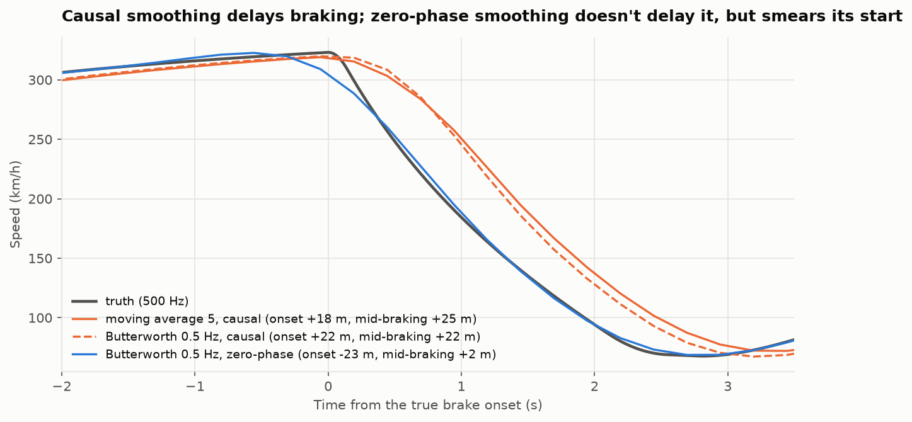
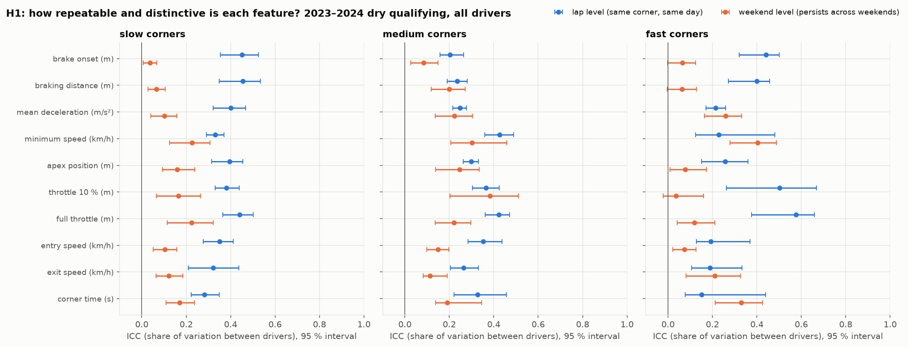
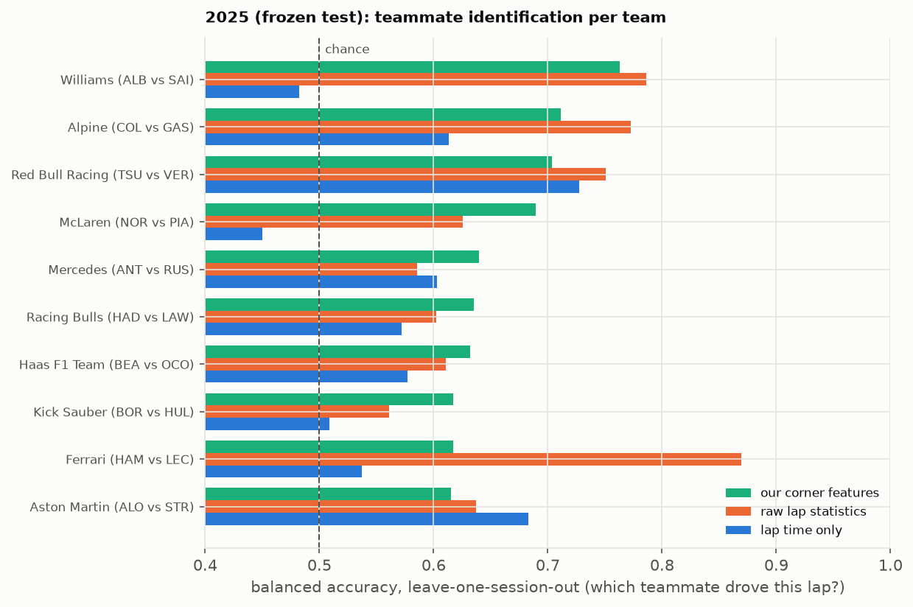
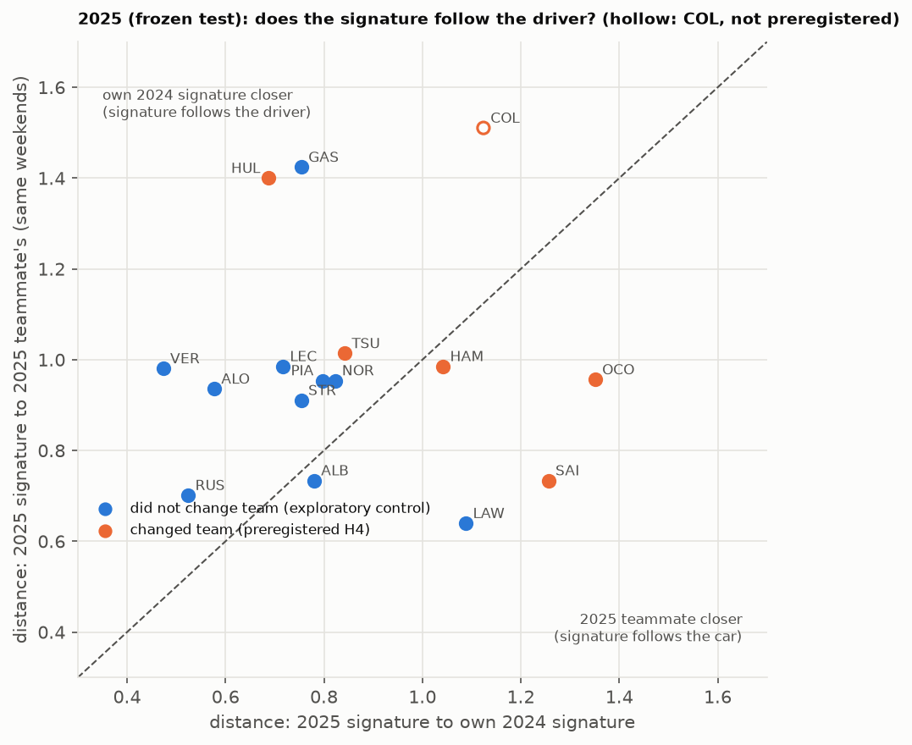

<!-- Generated by experiments/17_write_docs.py from docs/templates/report.md.j2: edit the template, not this file. Every number comes from results/. -->
# ApexTrace: driving signatures from low-rate public Formula 1 telemetry

**Sadman Zaman** · Department of Computer Science and Engineering, Bangladesh University of Engineering and Technology (BUET) · October 2026

## Abstract

Public Formula 1 timing data report each car's speed, throttle, an on/off brake flag, gear and position only
about 3.77 times per second, on an irregular clock with gaps. We ask whether signal-processing methods can still
extract repeatable, interpretable *driving signatures* from these data, whether those signatures identify a driver on
unseen sessions, and how much of them belongs to the driver rather than the car. We first quantify what the feed can
measure with synthetic laps of known truth, choose event estimators by Monte Carlo error, and place every lap on one
track coordinate with a complementary filter (1.15 m along-track error). From every braking zone of
66 dry qualifying sessions (2023–2025) we compute corner features such as brake onset, minimum speed and throttle pickup.
Features repeat lap to lap (intraclass correlation 0.15–0.58) but much less from weekend to weekend
(0.04–0.40). In a preregistered test on the held-out 2025 season, the features told teammates apart
on unseen weekends with balanced accuracy 0.662, against 0.575 for lap time (8 of 10 teams,
Wilcoxon p = 0.027), but not better than simple whole-lap statistics (0.680). Whether a signature follows a driver
to a new team was not supported: 2 of 5 team changers stayed closer to their own previous season than to
their new teammate (sign test p = 0.81).

## 1. Introduction

Television graphics and fan tools compare drivers through telemetry traces, but they rarely ask how precisely those
traces are measured, or whether an apparent difference would appear again next weekend. This project treats the
public feed as a measured signal with known limits, and tests four hypotheses, each of which could come out "no":

- **H1, repeatability.** Corner-level features vary less within a driver than between drivers.
- **H2, teammate differences.** Two teammates differ by more than the measurement error (pilot only).
- **H3, identification.** The features identify which of two teammates drove a lap, on sessions the model never
  saw, better than baselines including lap time alone.
- **H4, driver versus car.** A driver's signature follows them when they change teams.

We do not claim who is the better driver, anything faster than the data can show, or brake pressure (the public
brake channel is on/off).

**Contributions.** (i) An error budget for corner features from 3.77 Hz public telemetry, built from synthetic
laps with known truth. (ii) A reproducible pipeline from raw feed to field-relative corner features for every
qualifying session of 2023–2025. (iii) A leakage-free identification protocol with explicit baselines, replicated on a
season held out until a preregistered final test. (iv) A first, small test of whether driving style survives a change
of team, with an exploratory control. (v) A web application that shows every result with its uncertainty.

## 2. Data

**Source.** Timing data come from the official live-timing feed through two public interfaces. The pilot used FastF1;
when the F1 archive began refusing requests (HTTP 401) we switched to OpenF1, which serves the same feed. On the
pilot weekend (2024 Abu Dhabi), the two sources gave identical kept laps for 20 of 20 drivers in qualifying and
20 of 20 in practice, and brake-onset features within 0.23 m.

**What the feed is.** Car data arrive on a 40 ms clock at 3.77 samples per second on average (median interval
0.24 s, 5–95 % range 0.16–0.44 s, dropouts up to 1.36 s in the pilot session). At 300 km/h that is about 22 m
between samples, and nothing faster than 1.89 Hz can be resolved. Speed is reported in whole km/h, throttle in
whole percent, and the brake as on/off. Position (X/Y) is too coarse to show racing-line differences.

**Sessions.** Main qualifying sessions of 2023–2024 for development (47 sessions, 4,497 kept laps, 25 drivers)
and of 2025 for the final test (24 sessions; OpenF1 has no lap data for one, so 23 were built). Laps were kept by
FastF1-style rules (timed, accurate, green flag, not deleted, within 107 % of the best lap of the same stint).
Braking zones were detected automatically on each session's fastest kept lap and typed slow (< 120 km/h minimum),
medium or fast (≥ 200 km/h).

**Cleaning.** Rules were fixed in an exploratory data analysis of 2023–2024 and applied unchanged to 2025: dry
compounds only, corner passes with an implausible minimum speed dropped, and impossible feature values (for example,
braking after the corner marker) set to missing. This leaves 21,493 clean (driver, lap, corner) rows in
44 dry development sessions and 8,871 rows in 22 dry 2025 sessions.

**The frozen season.** From the first day, the code refused to load 2025 unless an environment flag was set, and the
final script refused to run unless the preregistration was committed, unchanged, and had not been run before.

## 3. Measurement science

Every estimator was tested on synthetic laps with a known truth (realistic speed profiles, the feed's irregular
sampling and dropouts, whole-unit quantisation), with 1,000 laps per corner type.

**Filtering moves events.** A causal 5-sample moving average shifted the middle of a braking event by
25.1 m, and a causal 0.5 Hz Butterworth filter by 22.3 m (group delay). Zero-phase filtering removes
the shift of the middle (3.4 m) but smears the onset −35.8 m early. Events are therefore located
on the raw samples, and smoothing is never used for a reported value.

**Estimator choices** (heavy-braking corners, root-mean-square error):

| Feature | Naive estimator | Chosen estimator |
|---|---|---|
| Brake onset | first sample with the brake on: 14.9 m (late by 12.5 m on average) | speed breakpoint inside the off→on interval: 4.2 m |
| Slowest point (apex) | lowest sample: 2.1 m | parabola through the three slowest samples: 1.0 m |
| Minimum speed | | parabola: 0.36 km/h |
| Throttle pickup (10 %) | first sample above: 3.2 m | interpolated crossing: 1.3 m |

Peak deceleration cannot be measured: the best estimator still had 8.0 m/s² error, so the mean deceleration from
brake onset to the slowest point is used instead.

**Alignment.** Projecting X/Y onto a reference path gives a track coordinate that is right on average but noisy;
integrating speed gives one that is smooth but drifts. A complementary filter (integrated speed plus a low-pass
correction from position, weighted by 1/speed²) gives 1.15 m along-track error in each corner window.

## 4. Features and statistical design

**Features.** For each (driver, lap, corner): brake onset, entry speed (200 m before the marker), minimum speed,
slowest point, braking distance, mean deceleration, throttle pickup, full throttle, exit speed (150 m after), corner
time and minimum gear (11 features). Positions are in metres from the corner marker. For comparisons across
tracks, each value is taken relative to the field median at the same corner and session (*field-relative*).

**Repeatability (H1).** The intraclass correlation ICC(1) gives the share of the variance that lies between drivers,
at two levels: laps within a weekend, and weekend means within a season. Intervals come from a bootstrap that
resamples whole driver-seasons.

**Identification (H3).** For each team-season, a logistic regression (with imputation and scaling fitted on training
data only) predicts which teammate drove a lap from 30 numbers: the field-relative mean of 10 features over the
lap's slow, medium and fast corners. Evaluation is leave-one-weekend-out, the score is balanced accuracy, and every
model is compared with a majority guess, lap time only, simple whole-lap statistics (mean and top speed, mean
throttle, share at full throttle, share braking) and shuffled labels. Ours vs lap time is a two-sided Wilcoxon
signed-rank test over teams.

**Driver vs car (H4).** A season signature is the mean of a driver's weekend means (each weekend counts once),
z-scored with the 2024 spread; the distance between signatures is the root-mean-square difference. For each
driver who changed teams for 2025, we ask whether their 2025 signature is closer to their own 2024 signature (another
car) than to their new teammate's 2025 signature (the same car, the same weekends). One-sided sign test over the
changers.

**Preregistration.** The pilot tests (Part A, commit `ab2510c`) and the final 2025 evaluation (Part B, commit
`225385c`) were committed before they were run. Deviations are reported in a separate file and below.

## 5. Results

### 5.1 Pilot (H2): too few laps, as predicted

Norris vs Piastri, 2024 Abu Dhabi qualifying, 4 and 4 push laps: 0 of 27 feature-by-corner comparisons survived
Benjamini–Hochberg correction, as the preregistration predicted from the smallest possible p-values. The largest
effects: Norris braked 7.4 m later at T5 (Hedges' g 2.2, p = 0.057) and 7.2 m later at T9 (g 1.9, p = 0.057):
consistent with a real difference, not confirmed.

### 5.2 Repeatability (H1): partly

Across all 2023–2024 drivers, lap-level ICCs ranged from 0.15 to 0.58, and weekend-level ICCs from 0.04 to
0.40. The lap-to-lap spread was 2.9 to 28 times the per-lap measurement error in all 21 cases where the error
was simulated, so the variation is the drivers', not the instrument's. The features that carry over best between
weekends are min_speed_kmh (fast, 0.40), throttle_pickup_m (medium, 0.38), corner_time_s (fast, 0.33). Brake onset at slow corners repeats within a weekend
(ICC 0.45) but hardly between weekends (0.04).

### 5.3 Identification (H3): supported, and replicated on 2025

| Balanced accuracy (mean over teams) | Development 2023–2024 (20 team-seasons) | Final 2025 (10 teams) |
|---|---|---|
| Corner features | 0.685 [0.654, 0.716] | **0.662** [0.634, 0.694] |
| Lap time only | 0.565 [0.538, 0.592] | 0.575 [0.527, 0.626] |
| Whole-lap statistics | 0.729 [0.680, 0.780] | 0.680 [0.621, 0.745] |
| Corner features, weekend vote | 0.763 | 0.746 |
| Shuffled labels | 0.500 | 0.507 |
| Ours better than lap time | 18 of 20, p < 0.001 | 8 of 10, p = 0.027 |
| Ours better than whole-lap statistics | 8 of 20, p = 0.14 | 5 of 10, p = 1 |

The preregistered criterion (Wilcoxon p < 0.05 and ours higher than lap time) was met on 2025. Shuffled labels sit at
chance, so the pipeline does not leak. Removing the throttle features costs the most (0.592 without them in
2025). The whole-lap statistics are as good or better; the extreme case is Ferrari 2025 (Hamilton vs Leclerc),
0.87 for whole-lap statistics vs 0.62 for corner features. Across all drivers of a season (a harder task: 21 and 22
drivers), corner features reached 0.240 in 2024 (chance 0.045, lap time 0.087, whole-lap statistics 0.287);
lap time alone is little better than chance there.

### 5.4 Driver vs car (H4): not supported

**Development (2023 → 2024, same car both years).** A driver's 2024 signature ranked their own 2023 signature
3.05 of 21 on average (chance 11; first for 12 of 20, permutation p < 0.001) and was closer to it than to the
teammate's for 17 of 20 drivers (p = 0.0013).

**Final test (2025 team changers).**

| Driver | 2024 → 2025 | Distance to own 2024 | Distance to new teammate | Closer to | Own 2024 rank |
|---|---|---|---|---|---|
| HAM | Mercedes → Ferrari (LEC) | 1.04 | 0.99 | new teammate | 4 of 22 |
| SAI | Ferrari → Williams (ALB) | 1.26 | 0.73 | new teammate | 15 of 22 |
| OCO | Alpine → Haas F1 Team (BEA) | 1.35 | 0.96 | new teammate | 12 of 22 |
| HUL | Haas F1 Team → Kick Sauber (BOR) | 0.69 | 1.40 | own 2024 | 1 of 22 |
| TSU | RB → Red Bull Racing (VER) | 0.84 | 1.01 | own 2024 | 2 of 22 |

2 of 5 changers stayed closer to their own past: sign test p = 0.81 (the smallest possible p with five drivers
was 0.031, so all five had to agree). H4 is not supported. Secondary results: the share of the lap spent
braking stayed closer to the driver's own for 4 of 5 (p = 0.19), and drivers who did not change
teams kept their signature against their old teammate for 10 of 11 (p = 0.0059).

**Exploratory, not preregistered.** Running the same comparison on the drivers who stayed (own 2024 vs current
teammate, same weekends) gave 8 of 10 (p = 0.055). Changers (2 of 5) and stayers (8 of 10) can't be told apart with
these numbers (Fisher's exact p = 0.25).

### 5.5 Deviations from the plan

1. The first final run crashed while downloading, before any result existed: OpenF1 has no lap data for 2025 Baku
   qualifying. The session is skipped (a one-line fix with a test); the deviation was recorded before the rerun.
2. Franco Colapinto (Williams → Alpine) also changed teams but was missing from the preregistered list. The primary test
   was kept as planned; with him included the result is 3 of 6 (p = 0.66), so the conclusion does not change.

## 6. Discussion

**What holds.** Within a team, corner-level telemetry carries a driver signature that generalises to unseen
weekends and to an unseen season, and that is stable from one year to the next for drivers who stay. It is weak
per lap and stronger per weekend (vote 0.746).

**Interpretability, not extra power.** Simple statistics of the whole lap identify teammates at least as well. The
value of the corner features is that they locate a difference (where a driver brakes, where they get back on the
throttle) with a known error, which the Corner lab in the web app makes visible.

**Driver or car.** The "no" for H4 has two readings that these data cannot separate: the car (its brakes, downforce
and set-up) shapes the measured style, or drivers adapt their style to a new car. The comparison is also not
symmetric: a driver's own signature is a year apart, while the teammate's comes from the same weekends. The
exploratory control suggests the own past usually wins when the car stays the same, but five changers are too few to
compare the groups.

**Limitations.** Qualifying laps only. A 3.77 Hz feed with an on/off brake signal and coarse positions. Corners are
detected per session, so the same corner can be typed differently in different years. The identification task is
between two teammates; the all-driver task is much harder. H4 rests on five drivers. While building the web app we
found that the projected track position may carry a lap-specific offset of a few metres; it would add noise to the
position features, and checking it over many laps is future work. The frozen results do not depend on it.

## 7. Conclusion and future work

Low-rate public telemetry supports corner-level features with known errors, and those features carry a
teammate-level driver signature that replicated on a held-out season. They do not beat simple lap statistics, and they
did not show that style follows a driver into a new car. Next steps: more team changes as seasons accumulate (and the
2026 regulation change, H5); features made relative to the teammate on each weekend to remove the car; the
position-offset check; a learned sequence model under the same held-out protocol; and a systematic literature search.

## Reproducibility

Everything runs from the repository: `pip install -r requirements.txt`, `pip install -e .`, then the numbered scripts
in `experiments/` (the data download, `08`–`09`, takes about an hour). Tests (`pytest`) use synthetic data only and run on
GitHub Actions. Every number in this report is filled in from the results files by `experiments/17_write_docs.py`. A
research log and a decision log record what was done and why, with dates.

## References

- Bell, A., Smith, J., Sabel, C. E. and Jones, K. (2016). Formula for success: multilevel modelling of Formula One
  driver and constructor performance, 1950–2014. *Journal of Quantitative Analysis in Sports*, 12(2), 99–112.
- Benjamini, Y. and Hochberg, Y. (1995). Controlling the false discovery rate: a practical and powerful approach to
  multiple testing. *Journal of the Royal Statistical Society, Series B*, 57(1), 289–300.
- Efron, B. and Tibshirani, R. J. (1993). *An Introduction to the Bootstrap*. Chapman & Hall.
- Enev, M., Takakuwa, A., Koscher, K. and Kohno, T. (2016). Automobile driver fingerprinting. *Proceedings on Privacy
  Enhancing Technologies*, 2016(1), 34–51.
- Hedges, L. V. (1981). Distribution theory for Glass's estimator of effect size and related estimators. *Journal of
  Educational Statistics*, 6(2), 107–128.
- Holm, S. (1979). A simple sequentially rejective multiple test procedure. *Scandinavian Journal of Statistics*, 6(2), 65–70.
- Nosek, B. A., Ebersole, C. R., DeHaven, A. C. and Mellor, D. T. (2018). The preregistration revolution. *Proceedings of
  the National Academy of Sciences*, 115(11), 2600–2606.
- Shrout, P. E. and Fleiss, J. L. (1979). Intraclass correlations: uses in assessing rater reliability. *Psychological
  Bulletin*, 86(2), 420–428.
- Wilcoxon, F. (1945). Individual comparisons by ranking methods. *Biometrics Bulletin*, 1(6), 80–83.
- FastF1 (Python package), https://github.com/theOehrly/Fast-F1, and OpenF1 (API), https://openf1.org.

## Acknowledgements

The software and much of the documentation were written with an AI coding assistant (Claude, by Anthropic) under the
author's direction; the author set the questions and the plan and reviewed and committed every change. ApexTrace is
unofficial and not associated with the Formula 1 companies; F1 and related marks are trade marks of Formula One
Licensing B.V.
